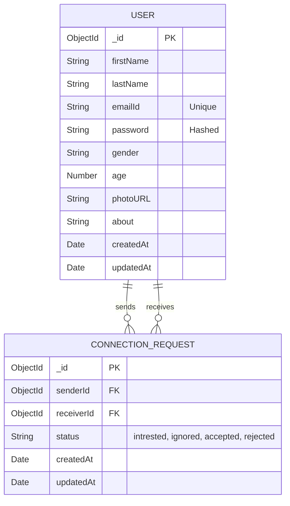

# DevTinder

A full-stack networking application designed to help developers connect, discover profiles, and build professional relationships. The platform operates similarly to social connection apps, allowing users to browse a curated feed of developers, send connection requests, and manage an active network.

**Tech Stack:** JavaScript · React · Node.js · Express · MongoDB · JWT · TailwindCSS

---

## 📌 Project Overview

DevTinder provides a focused environment for developers to find and connect with peers. It solves the problem of finding like-minded developers by offering a tailored feed, excluding users who are already connected or to whom requests have already been sent. 

The project is built using a modern MERN stack (MongoDB, Express, React, Node.js) and features a clean, responsive UI built with TailwindCSS and DaisyUI, backed by a robust RESTful API.

---

## 🚀 Features

The following features are currently implemented and functional:

* **User Authentication:** Secure registration and login using JWT stored in HTTP-only cookies.
* **Profile Management:** View, update (name, skills, age, photo, bio), and delete user profiles.
* **Password Management:** Secure password updating with BCrypt hashing and strength validation.
* **Developer Feed:** A paginated feed of developers, intelligently filtering out yourself, existing connections, and pending requests.
* **Connection Requests:** Swipe/Action to send requests (mark as "interested" or "ignored").
* **Request Management:** Review incoming connection requests and choose to "accept" or "reject".
* **Connections List:** View a complete list of your established connections.

---

## 🏗 Architecture

The application follows a standard Client-Server architecture.

```mermaid
flowchart TD
    Client[React Client (Vite)] -->|HTTP / REST| API[Express API Router]
    API --> Middleware[Auth Middleware]
    Middleware --> Controllers[Route Handlers]
    Controllers --> Models[Mongoose Models]
    Models --> DB[(MongoDB)]
```

---

## 💻 Tech Stack

| Technology | Purpose |
| ---------- | ------- |
| **Node.js (v22+)** | Backend runtime environment |
| **Express (v5.1.0)** | Backend web framework |
| **React (v19.1.0)** | Frontend UI library |
| **Vite (v7.0.4)** | Frontend build tool |
| **TailwindCSS (v4.1.11)** | Utility-first CSS styling |
| **DaisyUI (v5.0.47)** | Tailwind component library |
| **MongoDB / Mongoose (v8.16.3)** | NoSQL Database and Object Data Modeling |
| **JWT** | Stateless authentication mechanism |
| **BCrypt (v6.0.0)** | Password hashing |
| **Redux Toolkit (v2.8.2)** | Frontend state management |

---

## 📂 Project Structure

```text
DevTinder/
├── DevTinder - Client/         # Frontend React Application
│   ├── client/
│   │   ├── src/
│   │   │   ├── components/     # Reusable React components
│   │   │   ├── utils/          # Frontend utilities and Redux slices
│   │   │   ├── App.jsx         # Root application component
│   │   │   └── main.jsx        # Entry point
│   │   ├── package.json
│   │   └── vite.config.js
│
└── DevTinder - Server/         # Backend Node/Express API
    ├── src/
    │   ├── config/             # Database connection setup
    │   ├── models/             # Mongoose schemas (User, ConnectionRequest)
    │   ├── routes/             # API route definitions
    │   ├── utils/              # Authentication middleware & constants
    │   └── app.js              # Express application configuration
    └── package.json
```

---

## 🔄 Application Flow

### Authentication Flow

```text
Client
  ↓
POST /login (Credentials)
  ↓
Express Router (AuthUser.js)
  ↓
Mongoose (Find User & Validate BCrypt Hash)
  ↓
Generate JWT
  ↓
Attach JWT to Response Cookie
  ↓
Client (Authenticated)
```

### Connection Request Flow

```text
Client
  ↓
POST /request/sent/intrested/:userId
  ↓
Auth Middleware (Verify JWT Cookie)
  ↓
Express Router (connection.js)
  ↓
Validate Request (Check existing connection, self-request)
  ↓
Save to MongoDB (ConnectionRequest Collection)
  ↓
Response
```

---

## 📖 API Documentation

### Authentication (`/routes/AuthUser.js`)

#### `POST /signup`
Registers a new user.
* **Body:** `firstName`, `lastName`, `gender`, `age`, `emailId`, `password`, `photoURL`
* **Response:** User object and sets JWT cookie.

#### `POST /login`
Authenticates a user.
* **Body:** `emailId`, `password`
* **Response:** User object and sets JWT cookie.

#### `POST /logout`
Clears the JWT authentication cookie.

### Profile (`/routes/profile.js`)

#### `GET /profile`
* **Auth Required:** Yes
* **Response:** Current authenticated user's profile data.

#### `PATCH /update`
* **Auth Required:** Yes
* **Body:** Allowed fields (`firstName`, `lastName`, `skills`, `age`, `photoURL`, `about`)
* **Response:** Updated user object.

#### `PATCH /password`
* **Auth Required:** Yes
* **Body:** `password` (Must be a strong password)

#### `DELETE /delete`
* **Auth Required:** Yes
* **Response:** Deletes the authenticated user's account.

### Connections (`/routes/connection.js`)

#### `POST /request/sent/:status/:userId`
Send a connection request.
* **Auth Required:** Yes
* **Params:** 
  * `status`: Must be `intrested` or `ignored`
  * `userId`: Target user's MongoDB ObjectId

#### `POST /request/receive/:status/:userId`
Respond to an incoming connection request.
* **Auth Required:** Yes
* **Params:** 
  * `status`: Must be `accepted` or `rejected`
  * `userId`: Sender's MongoDB ObjectId

### User List / Feed (`/routes/userList.js`)

#### `GET /userList/feed`
Retrieves a paginated list of users for the feed, excluding the current user, existing connections, and pending requests.
* **Auth Required:** Yes
* **Query Params:** `page` (default 1), `limit` (default 10)

#### `GET /userList/request/received`
* **Auth Required:** Yes
* **Response:** List of users who have sent an "intrested" request.

#### `GET /userList/connection`
* **Auth Required:** Yes
* **Response:** List of all accepted connections.

---

## 🗄 Database Design



* **Constraints:** A user cannot send a connection request to themselves. Compound index on `(senderId, receiverId)` optimizes query performance for checking existing connections.

---

## 🔒 Security

* **Stateless Authentication:** Uses JWT (JSON Web Tokens) attached to HTTP-only cookies, preventing easy XSS token extraction.
* **Password Hashing:** Uses `bcrypt` with a cost factor of 10 for all passwords.
* **Data Validation:** Uses the `validator` library for strong password enforcement and email format verification at the schema level.
* **Authorization:** An auth middleware (`userAuth.js`) decodes the JWT and validates user existence before allowing access to protected routes.
* **Sanitization:** Updates are strictly filtered to a defined list of allowed fields (`allowedUpdates`) to prevent unintended data mutation or privilege escalation.

---

## 🛡 Error Handling and Validation

* Mongoose Schema validations enforce data integrity (min/max lengths, enums for gender and request status).
* Custom `pre("save")` hooks throw explicit errors if invalid operations are attempted (e.g., sending a request to oneself).
* Express route handlers use `try/catch` blocks and return appropriate HTTP status codes (400, 401, 404, 500) along with error messages.

---

## ⚙️ Setup and Installation

### Prerequisites
* Node.js (v18 or higher)
* MongoDB database instance

### Clone the Repository

```bash
git clone https://github.com/Goutham-Mallya-G/DevTinder.git
cd DevTinder
```

### Backend Setup

1. Navigate to the server directory:
   ```bash
   cd "DevTinder - Server"
   ```
2. Install dependencies:
   ```bash
   npm install
   ```
3. Configure Constants:
   Update `src/utils/const.js` with your MongoDB connection string (`mongo`) and a secure JWT secret (`jwt_secret_key`).
4. Start the server:
   ```bash
   npm start
   # Server will run on http://localhost:3000
   ```

### Frontend Setup

1. Navigate to the client directory:
   ```bash
   cd "DevTinder - Client"/client
   ```
2. Install dependencies:
   ```bash
   npm install
   ```
3. Start the development server:
   ```bash
   npm run dev
   # Client will run on http://localhost:5173
   ```

---

## 🏗 Design Decisions

* **JWT in Cookies:** Chosen over `localStorage` to allow seamless HTTP requests with credentials (`cors` configured with `credentials: true`), simplifying the frontend fetching logic.
* **NoSQL Database:** MongoDB is well-suited for dynamic profile data and rapid iteration.
* **Set Data Structure for Feed Filtering:** When generating the feed, a JavaScript `Set` is used to collect the IDs of users to hide (self, connections, pending). This provides $O(1)$ lookup complexity, making the feed generation highly performant before querying the database with `$nin`.

---

## 🔮 Potential Future Improvements

* Migrate secrets (DB URL, JWT Secret) from `utils/const.js` to an environment variables (`.env`) file for better security.
* Implement real-time chat functionality using WebSockets (Socket.io) for accepted connections.
* Containerize the application using Docker for easier deployment.
* Write unit and integration tests (e.g., Jest, Supertest).
* Implement refresh tokens for longer session validity.
